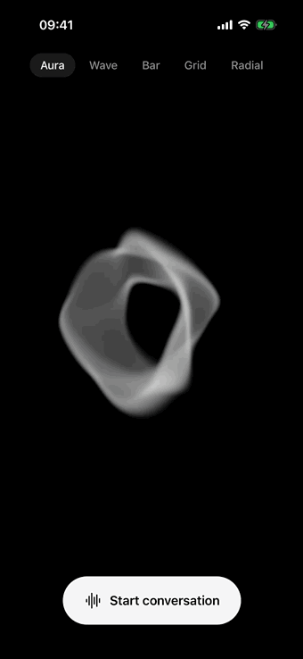
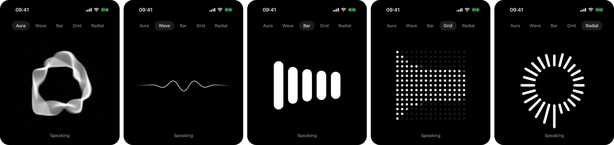

<div align="center">
  
  <h1>Expo LiveKit</h1>
  <p>
    A minimal voice agent starter for <a href="https://expo.dev">Expo</a> and <a href="https://livekit.io">LiveKit</a>.<br>
    Talk to an AI agent, watch its voice, and read the transcript as it streams.
  </p>
  <p>
    
    
    
  </p>
  
</div>

## What you get

- **One screen.** A live visualizer, a streaming transcript, and two controls: mute and end.
- **One hook.** All LiveKit session code is in [`use-voice-session.ts`](src/hooks/use-voice-session.ts).
- **One agent.** A [realtime voice agent](agent/agent.ts) in 33 lines.
- **One set of keys.** The model runs on LiveKit Inference. You need no OpenAI key.
- **No token server to run.** An [Expo Router API route](src/app/token+api.ts) issues LiveKit tokens.

## Quick start

You need Node.js 22.13 or newer, Xcode or Android Studio, and the [LiveKit CLI](https://docs.livekit.io/intro/basics/cli/) with a free [LiveKit Cloud](https://cloud.livekit.io) project.

```sh
npm install
npm --prefix agent install
lk cloud auth
lk app env -w
```

`lk app env -w` writes your LiveKit credentials to `.env.local`. Then start the agent and the app in two terminals:

```sh
npm run agent
```

```sh
npm run ios
```

For Android, use `npm run android`. The app needs a development build because Expo Go does not include WebRTC.

## Visualizers

The app shows all five audio visualizers from [LiveKit Agents UI](https://livekit.com/products/agents-ui). Change the style with the control at the top of the screen, also during a conversation.



The visualizers are web components. They run in an [Expo DOM component](https://docs.expo.dev/guides/dom-components/), and the app measures the audio level natively. To keep one style, set it in [`src/app/index.tsx`](src/app/index.tsx) and delete the other files in [`src/components/agents-ui/`](src/components/agents-ui).

## Project structure

```
src/
  app/
    _layout.tsx             Registers the LiveKit WebRTC globals
    index.tsx               The screen
    token+api.ts            Token endpoint. It runs on the server.
  hooks/
    use-voice-session.ts    Start, mute and end a conversation
  components/
    visualizer.tsx          Native audio levels for the visualizer
    agents-ui/              LiveKit Agents UI visualizers
    transcript.tsx          The live transcript
    segmented.tsx           The style control
    button.tsx              The mute, end and start buttons
  theme.ts                  Colors
agent/
  agent.ts                  The voice agent
```

## Make it yours

- Change the agent's instructions, voice and model in `agent/agent.ts`.
- Change the app name, icon and bundle identifiers in `app.json`.
- Change the colors in `src/theme.ts`.

## Ship it

- **Token endpoint.** In development, the Expo dev server runs the API route. For a production build, [deploy the route](https://docs.expo.dev/router/web/api-routes/#native-deployment) and add your user authentication to it.
- **Agent.** Deploy `agent/` to LiveKit Cloud with [`lk agent deploy`](https://docs.livekit.io/agents/ops/deployment/).

## Good to know

- **Echo on a simulator or emulator.** The agent can hear its own voice from your computer's speakers. Mute the microphone while the agent speaks.
- **Hidden logs.** [`use-voice-session.ts`](src/hooks/use-voice-session.ts) hides two harmless LiveKit logs that occur when a conversation ends. One has a fix in [client-sdk-js#2192](https://github.com/livekit/client-sdk-js/pull/2192) that is not released yet. Delete its line after you update `livekit-client`.
- **Transcript.** The transcript clears when a conversation ends.

## Credits

The visualizers come from [LiveKit Agents UI](src/components/agents-ui/README.md) (Apache 2.0). This template has the [MIT license](LICENSE).
